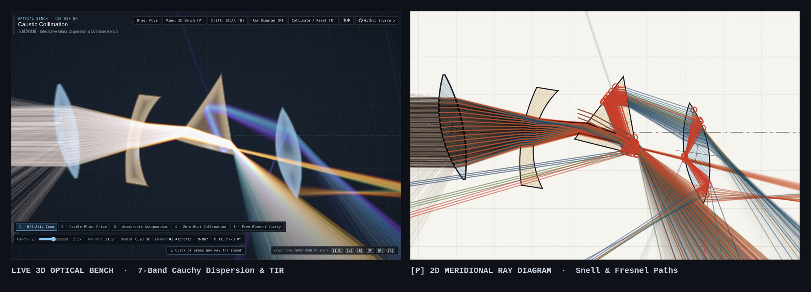

# Caustic Collimation (`caustic-collimation`)

An interactive WebGL2 3D optical bench exploring lens tilt, glass dispersion, and stereo overtone beating.

- **Live Optical Bench**: <https://h-void.github.io/caustic-collimation/?lang=en>
- **2D Ray Diagram Mode**: <https://h-void.github.io/caustic-collimation/?lang=en&print=1>

<p align="center">
  <a href="https://h-void.github.io/caustic-collimation/?lang=en">
    
  </a>
</p>

---

## Background

While building [`collima`](https://github.com/h-void/collima) to inspect focal-plane tilt and coma in real camera RAW files, I became interested in treating those optical defects as an interactive visual and acoustic system rather than flaws to eliminate. *Caustic Collimation* lets you translate and tilt 3–5 glass lenses and prisms on a WebGL2 bench while tracing seven visible wavelengths (`420–680 nm`) through Snell refraction, Schlick Fresnel reflections, and total internal reflection.

### Architecture

- **WebGL2 Transform Feedback Raytracing (`src/optics/shaders.ts`, `opticalBenchRenderer.ts`)**: Traces 7-band Cauchy glass dispersion (`N-BK7` crown and `SF11` dense flint, adjustable dispersion boost `γD`) across up to 12 surface bounces on GPU (`RGBA16F` accumulation with an automatic `sqrt(RGB)` `RGBA8` fallback on GPUs without float render targets).
- **2D Ray Diagram (`[P]` / `[V]`)**: Switches to a 14-bounce meridional ray-tracing diagram on light paper, showing Snell bending, internal reflections, and caustic intersections cleanly.
- **Tilt-Coupled Overtone Synth (`src/audio/prismAudioEngine.ts`)**: A 7-partial `AudioWorklet` synthesizer (`110 Hz` fundamental) maps glass element tilt (`±35°`) directly to stereo beating (`≤ 1.5 Hz`). Aligning the bench drops the beating to `0.00 Hz`.

---

## Controls & URL Parameters

| Input | Action |
| :--- | :--- |
| **Drag** | Translate selected optical element in `(x, z)` |
| **Shift + Drag / Right-Drag / `Drag: Tilt`** | Tilt element (`±35°`) |
| **`1` – `5`** | Switch optical presets (Off-Axis Coma, Double Flint Prism, Anamorphic Astigmatism, Zero-Beat Collimation, Five-Element Cavity) |
| **`V`** | Toggle 3D Bench and 2D Schematic views |
| **`B`** | Toggle gentle drift on the first element |
| **`P`** / `?print=1` | Toggle 2D Ray Diagram mode (`P` or `Esc` to exit) |
| **`R`** | Reset / collimate current preset |
| **`M`** | Toggle overtone sound |
| **URL Parameters** | `?lang=en\|zh-HK`, `?preset=1..5`, `?mode=schematic`, `?print=1`, `?seed=<u64>`, `?hud=pin` |

---

## Local Development

```bash
npm ci
npm run dev      # Local Vite dev server (http://127.0.0.1:4111)
npm run build    # TypeScript check + production build -> dist/
npm run preview  # Preview dist/ locally
```

## License

MIT
